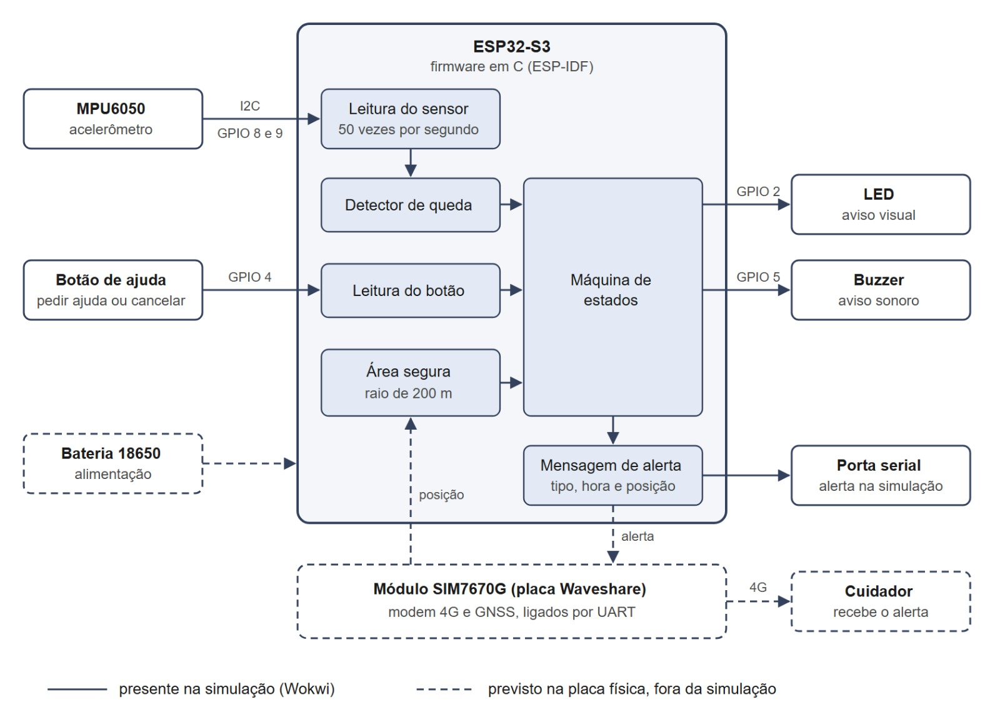
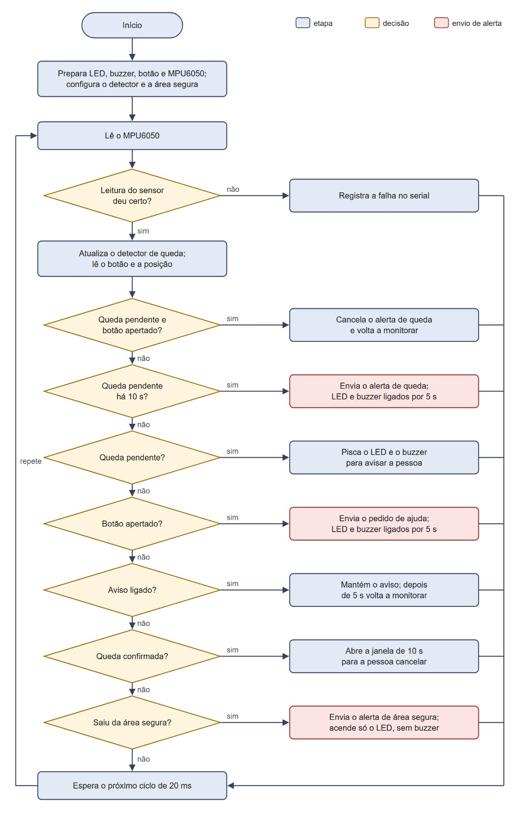
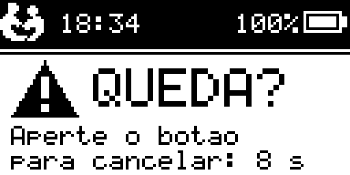

# MeuAmparo: seminário de desenvolvimento (28/10/2026)

Conteúdo dos slides e roteiro de fala. O PPTX `06-MeuAmparo_Desenvolvimento.pptx` é gerado a partir deste conteúdo, e a mesma fala está nas notas do apresentador.

Os trechos de código saem dos arquivos no momento em que o deck é gerado, com o número real das linhas e um link "ver no GitHub" para o mesmo trecho; se o código mudar, o deck precisa ser gerado de novo. Os links funcionam depois do push.

Duração sugerida: 20 a 25 minutos, mais a demonstração. Divisão da fala: Isa nos slides 1, 4, 5, 21, a parte das instituições no 22 e 24; Gustavo nos demais; cada um no seu bloco do slide 23. A divisão é sugestão; ajustem.

## 1. Capa

**Slide:** MeuAmparo. Seminário de desenvolvimento. Luis Gustavo Moda e Isabelly Vitoria. Programação de Microcontroladores, Estácio Ribeirão Preto, 28/10/2026.

**Fala (Isa):** O MeuAmparo é um dispositivo vestível para pessoas idosas que detecta queda, aceita pedido de ajuda pelo botão e avisa o cuidador com a localização. No seminário de planejamento mostramos o plano. Hoje mostramos o que foi construído, rodando no simulador, como o projeto está organizado e o que ainda falta até 25/11.

## 2. Onde estamos

**Slide:** três colunas.

- Pronto: detector de queda e máquina de estados, com testes; firmware com sensor, botão, LED, buzzer e visor; circuito e 4 cenários no Wokwi; 11 requisitos, diagrama de blocos e fluxograma (a validar com a Casa do Vovô).
- Em andamento: teste com dataset real (SisFall); registro dos testes; Roteiro 3 e relatos.
- Pendente: validação com a Casa do Vovô, reunião em 03/11; Lar Padre Euclides e Lar do Vovô Albano sem retorno.

Rodapé: backend e painel saíram do escopo.

**Fala (Gustavo):** O código andou mais rápido que o plano: o algoritmo, o firmware e a simulação estão funcionando. Os requisitos, o diagrama de blocos e o fluxograma também estão prontos, mas foram escritos antes de ouvir uma instituição: vamos validá-los na reunião com a coordenação da Casa do Vovô, marcada para 3 de novembro. As outras duas instituições não deram retorno. Também mudamos o escopo: o backend com painel de alertas saiu, e o esforço foi todo para o código embarcado.

## 3. Arquitetura: do sensor ao alerta

**Slide:** diagrama em quatro colunas.

- Entradas: MPU6050 (I2C 0x68), botão (GPIO 4), posição (fixa, sem GNSS).
- `firmware/main`: `mpu6050.c`, `main.c` (laço de 50 Hz), `position.c`.
- core, C puro: `fall.c` (queda em 3 fases), `device.c` (máquina de estados), `geofence.c` (área segura), `alert.c` (JSON do alerta).
- Saídas: `indicators.c` (LED e buzzer de 2 kHz), `display.c` (visor OLED), `transport_serial.c` (`MA_ALERT {json}`).
- Embaixo do core: `make test`, o mesmo core no Mac.

**Fala (Gustavo):** Este é o caminho de uma leitura até o alerta. À esquerda, o que entra: o sensor, o botão e a posição, que hoje é fixa porque o Wokwi não tem GNSS. O firmware lê e entrega tudo ao core, o bloco verde, que é C puro e decide: detecta a queda, controla os estados, confere a área segura e monta o alerta. À direita, o que sai: LED, buzzer, o visor e a linha MA_ALERT no serial. Embaixo está o motivo da separação: o mesmo core é compilado no computador pelo make test.

## 4. Diagrama de blocos do hardware

**Slide:** o diagrama, com a legenda "Diagrama: Isabelly Vitoria". Linha cheia: presente na simulação. Tracejado: previsto na placa física (modem 4G e GNSS do SIM7670G, bateria 18650). O alerta sai pela porta serial na simulação; na placa, sairia pelo modem 4G até o cuidador. Nota: o visor OLED entrou no firmware depois deste diagrama (28/10).

**Fala (Isa):** Este é o diagrama de blocos. O que está em linha cheia existe na simulação: o sensor e o botão entram no ESP32-S3, o firmware detecta a queda, confere a área segura e a máquina de estados decide o que acionar: LED, buzzer e a mensagem de alerta, que na simulação sai pela porta serial. O tracejado é o que fica para a placa física: o módulo SIM7670G, com 4G e GNSS, e a bateria. O visor OLED entrou no firmware depois do diagrama.

## 5. Fluxograma do firmware

**Slide:** o fluxograma, com a legenda "Diagrama: Isabelly Vitoria", e quatro pontos ao lado: um ciclo a cada 20 ms; decisões em ordem de prioridade; três saídas vermelhas (alerta de queda, pedido de ajuda, saída da área segura); falha de leitura não trava.

**Fala (Isa):** O fluxograma mostra um ciclo do firmware, que se repete a cada 20 milissegundos. Ele lê o sensor; se a leitura falhar, registra e segue. Depois atualiza o detector, lê o botão e a posição, e passa pelas decisões em ordem: se há queda pendente e o botão foi apertado, cancela; se a queda está pendente há 10 segundos, envia o alerta; e assim por diante. As caixas vermelhas são os três tipos de alerta.

## 6. Como as pastas estão organizadas

**Slide:** árvore em caixas.

- Raiz `meuamparo/`: `docs/` (`material-disciplina/`, `projeto/`), o que vai para a faculdade; `Makefile` da raiz.
- `src/meuamparo/`, o que roda:
  - `core/`: `include/meuamparo/` com `fall.h`, `device.h`, `geofence.h`, `alert.h`, `imu.h`, `types.h`; `src/` com os `.c`.
  - `firmware/`: `main/` com `main.c`, `mpu6050.c`, `display.c`, `indicators.c`, `position.c`, `transport_serial.c`, `i2c_bus.c`, `board.h`; `components/meuamparo_core`.
  - `simulator/wokwi/`: `diagram.json`, `wokwi.toml`, `scenarios/` com `botao.yaml`, `queda.yaml`, `queda-cancelada.yaml`, `pulo.yaml`.
  - `test/`: `test_fall.c`, `test_device.c`, `test_geofence.c`, `test_imu.c`, `ma_test.h`.

**Fala (Gustavo):** Esta é a árvore do repositório. À esquerda, docs, com o material da disciplina e o que o grupo produz, e o Makefile da raiz, que é por onde tudo começa. À direita, src/meuamparo, o que roda, em quatro pastas: core com os cabeçalhos e o código do detector, da máquina de estados, do geofence e do alerta; firmware com o main e um arquivo por periférico; simulator com o circuito, o wokwi.toml e os cenários; e test com um teste para cada módulo do core.

## 7. O core decide, o firmware executa

**Slide:**

- `core/` decide: C puro, sem nenhum header do ESP-IDF. Detector de queda, máquina de estados, área segura e formato do alerta.
- `firmware/` executa: ESP-IDF. Lê o MPU6050 por I2C e o botão, liga LED, buzzer e visor, envia o alerta. Sem mock nem cenário.
- `simulator/`: a bancada, com circuito e cenários do Wokwi.
- `test/`: a prova, com o core testado no computador.
- Por que dividimos: medir o detector contra centenas de registros em segundos, no Mac, sem gravar a placa; o mesmo `.c` compila nos dois lados, porque `components/meuamparo_core` aponta para `core/src`; trocar placa, visor ou transporte não mexe na lógica.

**Fala (Gustavo):** A regra mais importante do projeto é esta divisão. O core decide: é C puro, não inclui nada do ESP-IDF, e ali estão o detector de queda, a máquina de estados, o geofence e o formato do alerta. O firmware executa: lê o sensor por I2C e o botão, liga LED, buzzer e visor e manda o alerta, e não tem nenhum código de teste dentro. O simulator é a bancada e o test é a prova no computador. Por que dividir assim? Primeiro, para medir o detector contra centenas de registros em segundos, no Mac, sem gravar a placa a cada ajuste. Segundo, porque é o mesmo arquivo .c dos dois lados: o componente meuamparo_core do firmware aponta direto para core/src, não é uma cópia. Terceiro, se a placa, o visor ou o jeito de enviar o alerta mudarem, a lógica não muda.

## 8. O que usamos

**Slide:** seis cartões.

- C11 e ESP-IDF v5.5.5: framework oficial da Espressif para o ESP32.
- ESP32-S3: devkit no simulador; Waveshare SIM7670G no projeto.
- wokwi-cli 0.26.1: roda o firmware real no Wokwi, sem tela, nos cenários.
- Wokwi for VS Code 4.1.0: o mesmo circuito na tela, para ver e interagir.
- Make: um comando para testar, compilar e simular.
- GitHub e GPL v3: issues e quadro do projeto; código aberto.

**Fala (Gustavo):** Escrevemos em C com o ESP-IDF, que é o framework oficial da Espressif. O alvo é o ESP32-S3. Para simular usamos o Wokwi de dois jeitos: o wokwi-cli roda o firmware real sem tela, nos testes automáticos, e a extensão do VS Code mostra o mesmo circuito na tela para a gente interagir. O Make amarra tudo num comando. O código está no GitHub, com as tarefas nas issues, sob licença GPL v3.

## 9. Detector de queda em três fases

**Slide:** gráfico da magnitude da aceleração num trace sintético de queda: caminhada, queda livre perto de 0 g, pico de impacto acima de 2,5 g, pessoa parada em 1 g. Fases: queda livre abaixo de 0,5 g por 60 ms; impacto acima de 2,5 g em até 1 s; imobilidade perto de 1 g por 1,5 s. "Pulo também tem 1 e 2. A fase 3 separa queda de pulo."

**Fala (Gustavo):** O sensor mede a aceleração em três eixos e calculamos a magnitude, que não depende de como o dispositivo está preso. Em repouso ela fica em 1 g. Numa queda aparecem três coisas em sequência: a queda livre, quando a magnitude cai perto de zero; o impacto, um pico forte; e depois a pessoa parada no chão. A terceira fase é o que separa queda de pulo. Quem pula também tem queda livre e impacto, mas volta a se mexer.

## 10. O código do detector

**Slide:** `core/src/fall.c`, linhas 65–71 e 79–89 (os casos `MA_FALL_AWAIT_IMPACT` e `MA_FALL_STILLNESS`), com três pontos ao lado: 50 amostras por segundo; cada fase tem tempo limite; devolve `true` uma única vez.

**Fala (Gustavo):** O detector é uma máquina de estados alimentada a 50 amostras por segundo. Nas linhas 65 a 71, se o impacto não chega em um segundo, volta ao início. Nas linhas 79 a 89, na imobilidade, qualquer movimento cancela, e só depois de um segundo e meio parado a função devolve verdadeiro, uma única vez.

## 11. O que o dispositivo faz depois

**Slide:** diagrama de estados.

- Monitorando → (queda) → Queda pendente: LED e buzzer piscam por 10 s.
- Queda pendente → (botão) → Monitorando: a pessoa cancelou.
- Queda pendente → (10 s sem botão) → Alarme: alerta enviado; 5 s depois volta a monitorar.
- Monitorando → (botão) → Alarme: pedido de ajuda, sem espera.
- Monitorando → (saída da área segura) → Alarme: só LED, sem buzzer.

**Fala (Gustavo):** Detectar a queda não basta, falta decidir o que fazer. Depois de uma queda abrimos uma janela de 10 segundos em que o dispositivo avisa a própria pessoa e ela pode cancelar pelo botão, se estiver bem. É uma defesa contra alarme falso que não depende de afinar limiar. Fora dessa janela, o botão é pedido de ajuda e o alerta sai na hora. Na saída da área segura não tocamos o buzzer: quem está desorientado na rua não precisa de um apito, quem precisa saber é o cuidador.

## 12. A janela de cancelamento no código

**Slide:** `core/src/device.c`, linhas 40–52 e 54–62. Ao lado: linhas 40 a 41, botão em monitoramento vira alerta de ajuda na hora; linhas 42 a 48, a queda abre a janela (com janela zero, alerta direto); linhas 55 a 61, botão na janela cancela, sem botão sai o alerta de queda.

**Fala (Gustavo):** Aqui está a janela de cancelamento no código. No estado de monitoramento, o botão tem prioridade: se chegam botão e queda juntos, a pessoa está consciente e pediu ajuda. A queda abre a janela. No estado pendente, o botão cancela; passados os 10 segundos sem botão, o alerta de queda sai.

## 13. Firmware fino: lê, entrega ao core, obedece

**Slide:** `firmware/main/main.c`, linhas 173–183 e 224–226 (no momento da geração do deck), e a lista de arquivos: `mpu6050.c` (I2C, ±8 g), `indicators.c` (LED e buzzer por PWM), `display.c` (visor OLED 128x64), `position.c` (posição fixa, sem GNSS), `transport_serial.c` (alerta no serial).

**Fala (Gustavo):** Este é o coração do firmware. A cada 20 ms ele lê o sensor e o botão, entrega ao core e executa o que voltou: liga LED, buzzer e visor e, se for o caso, envia o alerta. O alerta é um JSON de uma linha com tipo, horário e posição. Na simulação ele sai no serial; na placa sairia pelo modem 4G, trocando um único arquivo.

## 14. Circuito e pinos

**Slide:** tabela.

| Componente | Função | Ligação no ESP32-S3 |
| ---- | ---- | ---- |
| MPU6050 | aceleração e rotação | I2C 0x68: SDA 8, SCL 9 |
| OLED SSD1306 | visor 128x64 | I2C 0x3C: mesmo barramento |
| Botão | pedido de ajuda e cancelamento | GPIO 4, pull-up |
| Buzzer | aviso sonoro, PWM 2 kHz | GPIO 5 |
| LED + 330 Ω | aviso visual | GPIO 2 |

Ao lado da tabela, a captura do visor no Wokwi durante a janela de cancelamento:

O OLED substitui o visor touch de 1,69" previsto, que o Wokwi não tem. Os pinos são do devkit; na Waveshare ESP32-S3-SIM7670G parte deles é do modem, e a pinagem precisa ser revista antes de montar.

**Fala (Gustavo):** O circuito usa o devkit ESP32-S3 do Wokwi com o sensor, o visor, o botão, o buzzer e o LED. Sensor e visor dividem o mesmo barramento I2C, cada um no seu endereço, então o visor não gastou pino. O buzzer recebe uma onda de 2 kHz, faixa em que o ouvido é mais sensível. O OLED entra no lugar do visor touch de 1,69 polegada, que o Wokwi não tem. E na placa escolhida parte desses pinos é do modem.

## 15. Um comando: make sim

**Slide:** a saída real do `make help` na raiz do repositório (test, setup, firmware, sim, sim-queda, sim-cancelada, sim-botao, sim-pulo, web, clean) e o que `make sim` faz, em ordem: carrega o ESP-IDF, lê o token do Wokwi de `~/.config/wokwi/token`, compila com `idf.py build`, roda os 4 cenários e para no primeiro que falhar. Rodapé: `make sim-queda`, `sim-cancelada`, `sim-botao` e `sim-pulo` rodam um cenário só, com o log inteiro na tela.

**Fala (Gustavo):** Tudo isso roda com um comando. Esta é a saída real do make help na raiz do repositório. O make sim carrega o ambiente do ESP-IDF sozinho, lê o token do Wokwi de um arquivo fora do repositório, compila o firmware e roda os quatro cenários, um atrás do outro. Se um falhar, para ali e mostra o log. Para a apresentação, os alvos sim-queda, sim-cancelada, sim-botao e sim-pulo rodam um cenário de cada vez, com tudo na tela.

## 16. O alvo sim por dentro

**Slide:** `src/meuamparo/Makefile`, linhas 102–112, e três pontos: `sim: firmware` depende do alvo firmware e sempre testa o binário recém-compilado; `$(WOKWI_TOKEN)` lê o token do arquivo, sem ele aparecer no repositório; `|| exit 1` faz o primeiro cenário que falhar interromper tudo.

**Fala (Gustavo):** Por dentro, o alvo sim está nas linhas 102 a 112 do Makefile. Ele depende do alvo firmware, então sempre testa o binário recém-compilado. Lê o token do Wokwi de um arquivo fora do repositório, roda cada cenário com o wokwi-cli e, se um falhar, para tudo.

## 17. Cenários: o sistema inteiro testado sozinho

**Slide:** `simulator/wokwi/scenarios/queda.yaml`, linhas 7–22. Ao lado: `set-control` mexe no sensor ou aperta o botão; `wait-serial` espera uma linha no serial do firmware; `expect-pin` confere o nível de um pino, como o LED. 4/4 cenários passaram: botão, queda, queda cancelada, pulo.

**Fala (Gustavo):** Cada cenário é um teste do sistema inteiro: o firmware real rodando no Wokwi. Este é o da queda. Ele espera o dispositivo ficar pronto, leva o sensor a 0,1 g por 300 ms, que é a queda livre, depois a 4 g, que é o impacto, e deixa a pessoa deitada. Aí espera a linha "queda confirmada", depois o MA_ALERT do tipo fall, e confere que o LED está aceso. São quatro cenários, e os quatro passam. Se alguém mexer no limiar e quebrar a detecção, o make sim acusa.

## 18. Ver e interagir: a extensão do Wokwi

**Slide:** quatro passos (abrir `src/meuamparo/simulator/wokwi` no VS Code; F1 → Wokwi: Request a new License, só na primeira vez; F1 → Wokwi: Start Simulator; clicar no botão, mexer nos sliders do MPU6050, ler o visor e o serial) e `simulator/wokwi/wokwi.toml`, linhas 3–6. Sem VS Code: `make web` gera um `.bin` para subir no wokwi.com.

**Fala (Gustavo):** Para ver o circuito e mexer nele, usamos a extensão do Wokwi no VS Code. Abre a pasta do simulador, pede a licença uma vez pela conta Wokwi e manda iniciar. O arquivo wokwi.toml aponta para o mesmo binário que os cenários testam, então o que aparece na tela é o firmware que passou nos testes. Quem não usa VS Code pode rodar make web e subir o arquivo no wokwi.com.

## 19. Testes em duas camadas

**Slide:** dois painéis.

- `make test` no computador, 50 traces sintéticos por atividade: queda forte 50/50; queda amortecida 22/50; nenhum alarme falso em andar, correr, pular, sentar com força, deitar e cair e levantar. Aviso: traces escritos pelo grupo, não medem a meta de 90%; a medição usará o SisFall.
- `make sim` no Wokwi: 4/4 cenários passaram.

**Fala (Gustavo):** Testamos em duas camadas. No computador, o detector roda contra traces que nós mesmos escrevemos: pega todas as quedas fortes e menos da metade das amortecidas, e não dispara em nenhuma atividade comum. Esse número não é a meta de 90%, porque o trace foi escrito sabendo como o detector funciona. A medição de verdade vai usar o SisFall, um conjunto público de registros de quedas. No Wokwi, os quatro cenários testam o sistema inteiro.

## 20. O que esse jeito de trabalhar nos dá

**Slide:** quatro cartões.

- 1 comando: `make sim` reproduz tudo.
- 1 código: o mesmo C no Mac e na placa.
- 4 cenários: regressão do sistema integrado.
- Limites claros: traces sintéticos, sem hardware, GNSS fixo, dito em voz alta.

**Fala (Gustavo):** Para fechar a parte técnica: um comando reproduz tudo. O mesmo código C roda no computador e na placa, então o detector é afinado em segundos, não em ciclos de gravar e testar. Os cenários funcionam como teste de regressão do sistema inteiro. E fazemos questão de dizer o que não está provado: os traces são sintéticos, não houve hardware e a posição é fixa.

## 21. Demonstração ao vivo

**Slide:** escuro. No terminal, na raiz do repositório:

- `make sim-queda`: queda, janela de 10 s e alerta com posição.
- `make sim-cancelada`: queda cancelada pelo botão dentro da janela.
- `make sim-botao`: pedido de ajuda pelo botão.
- `make sim-pulo`: pulo, que não pode gerar alerta.

Cada um mostra os avisos narrados pelo firmware: QUEDA LIVRE → IMPACTO → PESSOA PARADA, DEITADA → QUEDA DETECTADA → ALERTA ENVIADO. Depois, Wokwi no VS Code: circuito ao vivo, botão e visor.

**Fala (Isa):** Agora a simulação rodando. Cada comando roda um cenário e o firmware narra o que está acontecendo: queda livre, impacto, pessoa parada e deitada, queda detectada, alerta enviado. Começamos pela queda, depois a queda cancelada, o botão e o pulo, que não pode gerar alerta. Por fim, o circuito ao vivo no VS Code, com o botão e o visor.

Preparação antes da aula: rodar `make firmware`, deixar o VS Code aberto em `src/meuamparo/simulator/wokwi` com a licença ativa e um terminal na raiz do repositório.

## 22. Dificuldades e problemas

**Slide:** seis cartões.

- Instituições: só a Casa do Vovô aceitou, com reunião presencial com a coordenação marcada para 03/11/2026, às 13h30. O Lar Padre Euclides não respondeu nem atendeu; no Lar do Vovô Albano, sem retorno da assistente social.
- Requisitos: os 11 requisitos foram escritos antes da escuta, a partir dos objetivos do projeto, e concluídos com atraso no fim de outubro; serão validados na reunião.
- Tempo e custo: em 16/09 decidimos não comprar a placa, sem tempo hábil até a entrega. Waveshare ESP32-S3-SIM7670G-4G estimada em R$ 597 a R$ 622 por unidade (setembro de 2026; estimativa, não preço atual).
- Wokwi: primeira vez usando (token de CI, licença da extensão, cenários).
- Só simulação: o Wokwi não tem GNSS nem modem 4G; posição fixa e alerta no serial.
- Ambiente: queda difícil de provocar com slider; a atualização do Python pelo Homebrew quebrou o ambiente do ESP-IDF (resolvido no Makefile).

**Fala (Isa):** A maior dificuldade foi o contato com as instituições. Liguei para as três: o Lar Padre Euclides não respondeu nem atendeu, e no Lar do Vovô Albano fiquei sem retorno da assistente social. Só a Casa do Vovô aceitou, e a reunião com a coordenação está marcada para 3 de novembro. Por isso os requisitos foram escritos antes de ouvir a instituição, a partir dos objetivos do projeto, e ficaram prontos com atraso no fim de outubro. Vamos levá-los para validar na reunião. Também pesaram o tempo e o custo: em 16 de setembro decidimos não comprar a placa, que sairia entre 597 e 622 reais, estimativa de setembro.

**Fala (Gustavo):** No técnico, foi a primeira vez que usamos o Wokwi: o token de CI, a licença da extensão e os cenários automáticos. A simulação tem limite: o Wokwi não tem GNSS nem modem 4G, então a posição é fixa e o alerta sai no serial. Provocar a queda com o slider é difícil, e por isso escrevemos os cenários. E uma atualização do Python pelo Homebrew quebrou o ambiente do ESP-IDF, o que resolvemos no Makefile.

## 23. O que cada um fez e aprendeu

**Slide:** duas colunas, cada uma terminando com a pergunta "O que eu aprendi?", para responder ao vivo.

- Gustavo: arquitetura do código; detector, máquina de estados e firmware; circuito, visor e cenários no Wokwi; repositório, Makefile e modelo do case.
- Isa: contato com as três instituições e reunião marcada na Casa do Vovô (03/11); escopo e 11 requisitos funcionais, cada um com forma de verificação; diagrama de blocos e fluxograma; cronograma e slides.

**Fala (cada um):** cada um fala o próprio bloco, em primeira pessoa. "O que eu aprendi?": falar ao vivo.

## 24. Limites e próximos passos

**Slide:** duas colunas.

- O que a simulação não prova: autonomia de 8 horas; conforto e fixação; alarme falso no dia a dia; cobertura do 4G e precisão do GPS.
- Até 25/11: reunião com a Casa do Vovô (03/11) para validar requisitos e diagramas; medir o detector com o SisFall; GPS, que hoje é uma posição fixa (falta o driver do GNSS ou um chip simulado); avaliação de reação com a instituição; Roteiro 3 e relatos; seminário de avaliação.

**Fala (Isa):** O simulador cobre a lógica e a demonstração. Autonomia, conforto e alarme falso no uso real só se medem com a placa e com pessoas. Até 25/11 temos a reunião com a coordenação da Casa do Vovô em 3 de novembro, para validar os requisitos e os diagramas, a medição do detector com dados reais, a avaliação de reação com a instituição e o relatório final. Obrigado.
